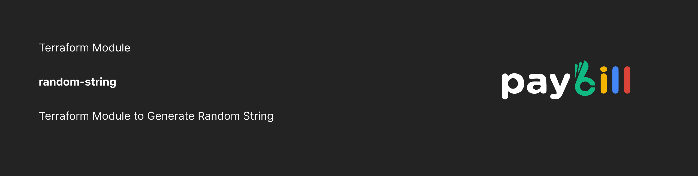

  <a href="https://paybill.dev" target="_blank">
    <picture>
      
    </picture>
  </a>

# Terraform Module: Random String Generator  

## Overview

Random String Geneartor

<!-- BEGIN_TF_DOCS -->
## Requirements

No requirements.

## Providers

| Name | Version |
|------|---------|
|  [random](#provider\_random) | n/a |

## Modules

No modules.

## Resources

| Name | Type |
|------|------|
| [random_password.password](https://registry.terraform.io/providers/hashicorp/random/latest/docs/resources/password) | resource |

## Inputs

| Name | Description | Type | Default | Required |
|------|-------------|------|---------|:--------:|
|  [is\_lower](#input\_is\_lower) | Include lowercase alphabet characters in the result | `bool` | `"true"` | no |
|  [is\_numeric](#input\_is\_numeric) | Include numeric characters in the result | `bool` | `"true"` | no |
|  [is\_special](#input\_is\_special) | Include special characters in the result. | `bool` | `"true"` | no |
|  [is\_upper](#input\_is\_upper) | Include uppercase alphabet characters in the result | `bool` | `"true"` | no |
|  [length](#input\_length) | The length of the string desired. | `number` | `"1"` | no |
|  [min\_lower](#input\_min\_lower) | Minimum number of lowercase alphabet characters in the result | `number` | `0` | no |
|  [min\_numeric](#input\_min\_numeric) | Minimum number of numeric characters in the result | `number` | `0` | no |
|  [min\_special](#input\_min\_special) | Minimum number of special characters in the result | `number` | `0` | no |
|  [min\_upper](#input\_min\_upper) | Minimum number of uppercase alphabet characters in the result | `number` | `0` | no |
|  [override\_special](#input\_override\_special) | Supply your own list of special characters to use for string generation | `string` | `""` | no |

## Outputs

| Name | Description |
|------|-------------|
|  [result](#output\_result) | The generated random string |
<!-- END_TF_DOCS -->